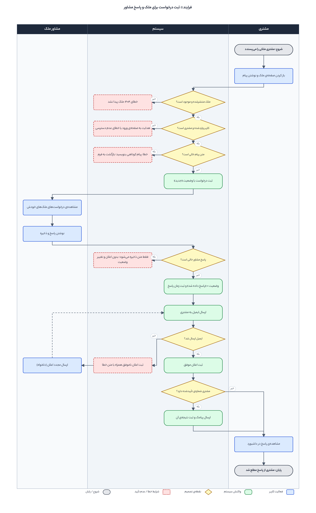
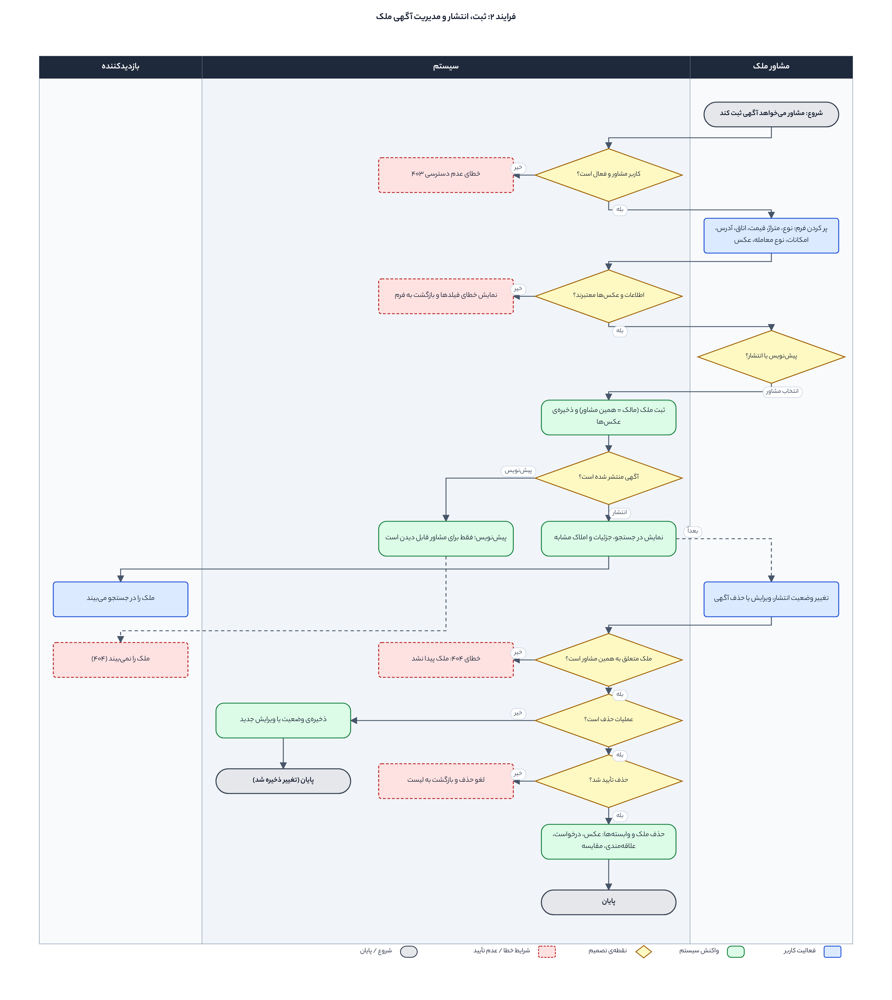
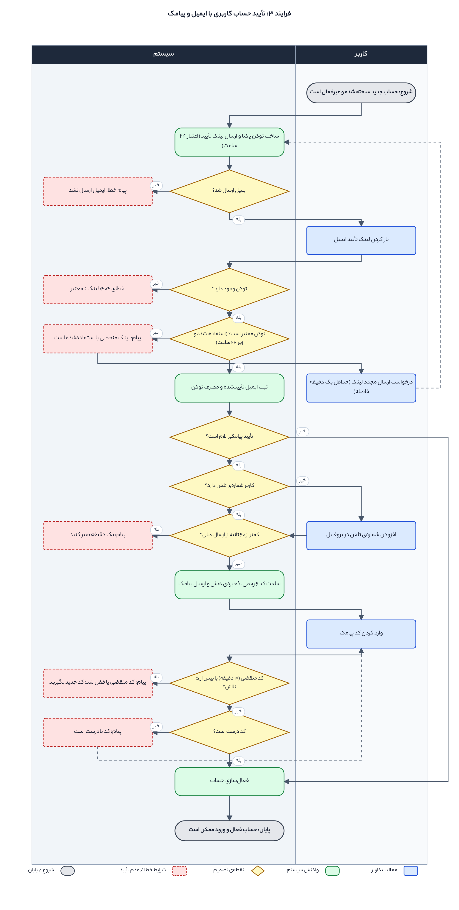
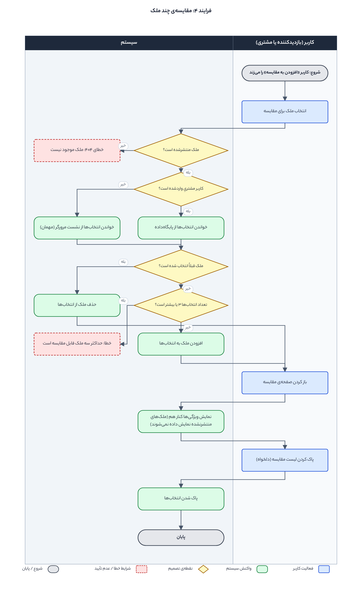
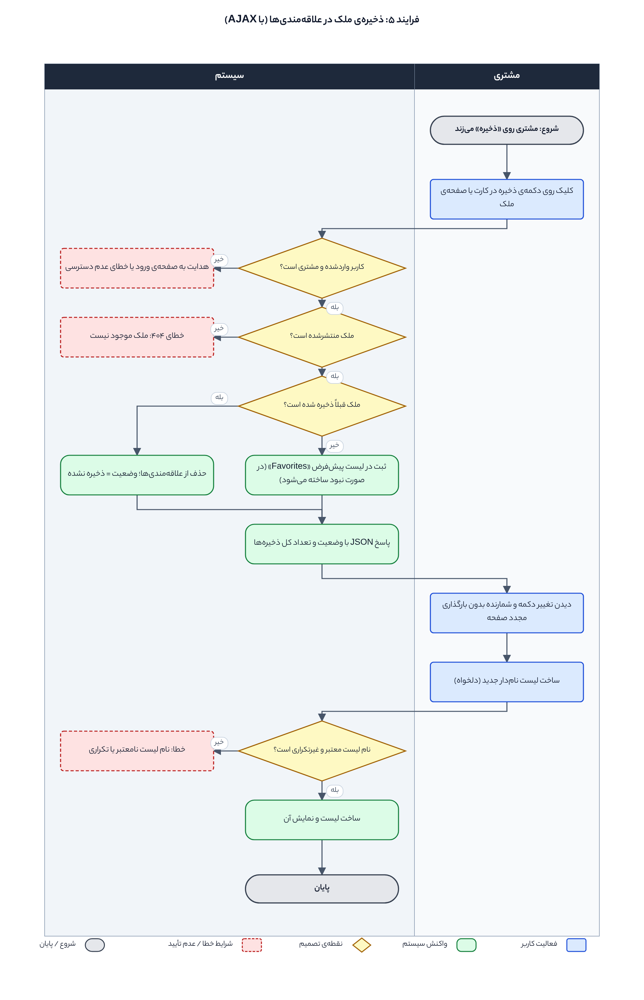
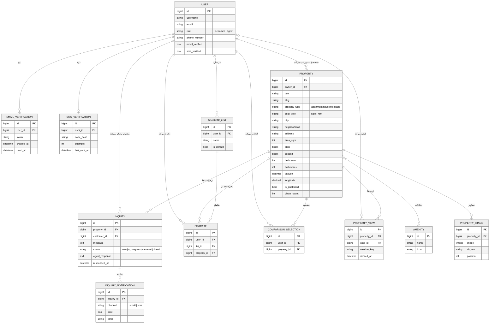

موارد فاز اول: ۱) تعریف وب اپلیکیشن‌ها ۲) طراحی فرایندهای وب اپلیکیشن‌ها ۳) طراحی و تعریف مدل‌ها

نام و نام خانوادگی: محمد حسین جباری - مجتبی عادلی
درس / استاد: دکتر ندا سلطانی

---

## ۱. تعریف وب اپلیکیشن‌ها

| اپلیکیشن | مسئولیت |

| --- | --- |

| `accounts` | کاربران سایت (مشتری / مشاور املاک)، نقش کاربر و رکوردهای تأیید ایمیل و پیامک |

| `properties` | املاک، امکانات ملک، تصاویر ملک و سابقه‌ی بازدید از ملک |

| `inquiries` | درخواست‌های کاربران برای ملک و پاسخ مشاور، لیست علاقه‌مندی‌ها، مقایسه‌ی املاک و سابقه‌ی اعلان‌های ایمیل/پیامک |

| `core` | هسته‌ی سایت؛ در فاز دوم صفحات (view/url/template) و فرم‌ها در آن تعریف می‌شوند |

این اپلیکیشن‌ها در `INSTALLED_APPS` فایل `config/settings.py` ثبت شده‌اند. پایگاه‌داده PostgreSQL است و مدل کاربر سفارشی با `AUTH_USER_MODEL = "accounts.User"` تعریف شده است.

---

## ۲. طراحی فرایندهای وب اپلیکیشن‌ها

برای وب‌سایت، **پنج فرایند اصلی** شناسایی شد و برای هر کدام یک نمودار مستقل (Swimlane) رسم شده است. فرایندهای روتین مثل ثبت‌نام و ورود، افزودن/ویرایش/حذف ساده‌ی موجودیت‌ها و جستجو و فیلتر ساده طبق صورت تکلیف رسم نشده‌اند.

### راهنمای نمودارها

هر **ستون** یک نقش است (مثلاً مشتری، مشاور، سیستم).
ستون‌های «مشتری / مشاور / کاربر / بازدیدکننده» **فعالیت‌های انسانی** (آبی) و ستون «سیستم» **واکنش‌های سیستم** (سبز) را نشان می‌دهد.
لوزی زرد = نقطه‌ی تصمیم‌گیری؛ کادر قرمز خط‌چین = شرایط خطا یا عدم تأیید؛ بیضی خاکستری = شروع/پایان.
خط‌چین = مسیر بازگشت یا مسیر اختیاری.

| شماره | فرایند | اپلیکیشن‌های درگیر | نقش‌ها |

| --- | --- | --- | --- |

| ۱ | ثبت درخواست برای ملک و پاسخ مشاور | `inquiries`, `properties`, `accounts` | مشتری، مشاور، سیستم |

| ۲ | ثبت، انتشار و مدیریت آگهی ملک | `properties`, `accounts` | مشاور، بازدیدکننده، سیستم |

| ۳ | تأیید حساب کاربری با ایمیل و پیامک | `accounts` | کاربر، سیستم |

| ۴ | مقایسه‌ی چند ملک | `inquiries`, `properties` | بازدیدکننده / مشتری، سیستم |

| ۵ | ذخیره‌ی ملک در علاقه‌مندی‌ها (AJAX) | `inquiries`, `properties` | مشتری، سیستم |

---

### فرایند ۱: ثبت درخواست برای ملک و پاسخ مشاور

**هدف:** مشتری درباره‌ی یک ملک منتشرشده سؤال می‌پرسد و مشاور پاسخ می‌دهد و مشتری از پاسخ مطلع می‌شود.
**نقش‌ها:** مشتری، مشاور ملک، سیستم.
**مراحل اصلی:**
  1. مشتری در صفحه‌ی ملک پیام را می‌نویسد و ارسال می‌کند.

  2. سیستم بررسی می‌کند ملک منتشرشده باشد، کاربر واردشده و مشتری باشد و پیام خالی نباشد؛ سپس درخواست را با وضعیت «جدید» ثبت می‌کند.

  3. مشاور درخواست‌های ملک‌های خودش را می‌بیند و پاسخ می‌نویسد.

  4. سیستم وضعیت را «پاسخ داده شد» می‌کند، زمان پاسخ را ثبت و ایمیل می‌فرستد؛ اگر مشتری شماره‌ی تأییدشده داشته باشد پیامک هم می‌فرستد. نتیجه‌ی هر ارسال در `InquiryNotification` ذخیره می‌شود.

  5. مشتری پاسخ را در داشبورد خودش می‌بیند.

**مسیرهای جایگزین و خطا:** ملک منتشرنشده یا حذف‌شده (۴۰۴)، کاربر واردنشده یا مشاور (ورود/عدم دسترسی)، پیام خالی (بازگشت به فرم)، پاسخ خالی (فقط ذخیره، بدون اعلان)، شکست ارسال ایمیل (ثبت اعلان ناموفق و امکان «ارسال مجدد» توسط مشاور).

---

### فرایند ۲: ثبت، انتشار و مدیریت آگهی ملک

**هدف:** مشاور آگهی ملک را ثبت می‌کند و تعیین می‌کند آگهی پیش‌نویس بماند یا برای عموم منتشر شود؛ سپس آن را مدیریت می‌کند.
**نقش‌ها:** مشاور ملک، بازدیدکننده، سیستم.
**مراحل اصلی:**
  1. سیستم بررسی می‌کند کاربر مشاور و فعال باشد.

  2. مشاور فرم ملک (نوع، متراژ، قیمت، تعداد اتاق، آدرس، امکانات، نوع معامله، عکس‌ها) را پر می‌کند.

  3. سیستم اطلاعات و عکس‌ها را اعتبارسنجی می‌کند و ملک را با مالکیت همین مشاور ذخیره می‌کند.

  4. مشاور «پیش‌نویس» یا «انتشار» را انتخاب می‌کند. آگهی منتشرشده در جستجو، جزئیات و املاک مشابه دیده می‌شود؛ پیش‌نویس فقط برای خود مشاور قابل مشاهده است.

  5. بعداً مشاور وضعیت انتشار را تغییر می‌دهد، ویرایش می‌کند یا حذف می‌کند. حذف نیاز به تأیید دارد و درخواست‌ها، عکس‌ها، علاقه‌مندی‌ها و مقایسه‌های وابسته را هم حذف می‌کند.

**مسیرهای جایگزین و خطا:** کاربر غیرمشاور یا غیرفعال (۴۰۳)، داده‌ی نامعتبر (نمایش خطا و بازگشت به فرم)، ملک متعلق به مشاور دیگر (۴۰۴)، لغو حذف، و دیده نشدن پیش‌نویس برای بازدیدکننده (۴۰۴).

---

### فرایند ۳: تأیید حساب کاربری با ایمیل و پیامک

**هدف:** حساب تازه‌ساخته‌شده (غیرفعال) پس از تأیید ایمیل (و در صورت نیاز تأیید پیامکی) فعال شود.
**نقش‌ها:** کاربر، سیستم.
**مراحل اصلی:**
  1. سیستم توکن یکتا می‌سازد و لینک تأیید (اعتبار ۲۴ ساعت) را ایمیل می‌کند.

  2. کاربر لینک را باز می‌کند؛ سیستم وجود و اعتبار توکن را بررسی و ایمیل را تأیید می‌کند.

  3. اگر تأیید پیامکی الزامی باشد (بخش امتیازی)، سیستم کد ۶ رقمی را (به‌صورت هش) ذخیره و پیامک می‌کند و کاربر کد را وارد می‌کند.

  4. با کد درست حساب فعال می‌شود و ورود ممکن است.

**مسیرهای جایگزین و خطا:** شکست ارسال ایمیل، توکن نامعتبر (۴۰۴)، توکن منقضی یا استفاده‌شده (درخواست ارسال مجدد با حداقل یک دقیقه فاصله)، نبود شماره‌ی تلفن (افزودن در پروفایل)، درخواست کد در کمتر از ۶۰ ثانیه، کد منقضی (۱۰ دقیقه)، قفل شدن پس از ۵ تلاش ناموفق و کد نادرست.

---

### فرایند ۴: مقایسه‌ی چند ملک

**هدف:** کاربر حداکثر سه ملک را انتخاب کند و ویژگی‌هایشان را کنار هم ببیند.
**نقش‌ها:** بازدیدکننده یا مشتری، سیستم.
**مراحل اصلی:**
  1. کاربر «افزودن به مقایسه» را می‌زند.

  2. سیستم بررسی می‌کند ملک منتشرشده باشد. انتخاب‌های مشتری واردشده در پایگاه‌داده و انتخاب‌های مهمان در نشست مرورگر نگه‌داری می‌شود.

  3. اگر ملک قبلاً انتخاب شده باشد از لیست حذف می‌شود؛ وگرنه در صورتی که تعداد انتخاب‌ها کمتر از ۳ باشد اضافه می‌شود.

  4. کاربر صفحه‌ی مقایسه را باز می‌کند و جدول ویژگی‌ها را می‌بیند؛ در صورت تمایل لیست را پاک می‌کند.

**مسیرهای جایگزین و خطا:** ملک منتشرنشده (۴۰۴) و رسیدن به سقف ۳ ملک (پیام خطا).

---

### فرایند ۵: ذخیره‌ی ملک در علاقه‌مندی‌ها (AJAX)

**هدف:** مشتری ملک را بدون بارگذاری مجدد صفحه ذخیره یا از ذخیره‌ها خارج کند و در صورت تمایل لیست‌های نام‌دار بسازد.
**نقش‌ها:** مشتری، سیستم.
**مراحل اصلی:**
  1. مشتری روی دکمه‌ی ذخیره می‌زند (درخواست Fetch/AJAX).

  2. سیستم بررسی می‌کند کاربر واردشده و مشتری باشد و ملک منتشرشده باشد.

  3. اگر ملک قبلاً ذخیره شده باشد حذف می‌شود؛ وگرنه در لیست پیش‌فرض «Favorites» (در صورت نبود ساخته می‌شود) ثبت می‌شود.

  4. سیستم پاسخ JSON (وضعیت و تعداد کل) برمی‌گرداند و دکمه و شمارنده بدون رفرش صفحه به‌روز می‌شوند.

  5. مشتری در صورت تمایل لیست نام‌دار جدید می‌سازد.

**مسیرهای جایگزین و خطا:** کاربر واردنشده یا مشاور (ورود/عدم دسترسی)، ملک منتشرنشده (۴۰۴) و نام لیست نامعتبر یا تکراری.

---

## ۳. طراحی و تعریف مدل‌ها

### accounts

| مدل | توضیح و روابط |

| --- | --- |

| `User` | ارث‌بر از `AbstractUser`. فیلدهای `role` (customer / agent)، `phone_number`، `email_verified`، `sms_verified` |

| `EmailVerification` | ForeignKey به `User` (چند به یک). توکن یکتا، زمان ساخت و زمان استفاده |

| `SMSVerification` | OneToOne با `User`. هش کد، تعداد تلاش‌ها، زمان آخرین ارسال |

### properties

| مدل | توضیح و روابط |

| --- | --- |

| `Amenity` | امکانات ملک؛ نام یکتا و آیکن اختیاری |

| `Property` | ForeignKey به `User` (مشاور مالک `owner`)، ManyToMany با `Amenity`. نوع ملک، نوع معامله، شهر، محله، آدرس، متراژ، قیمت، ودیعه، تعداد اتاق و سرویس، سال ساخت، مختصات روی نقشه، وضعیت انتشار، تعداد بازدید. ایندکس روی (شهر، نوع معامله، انتشار) |

| `PropertyImage` | ForeignKey به `Property`؛ تصویر، متن جایگزین و ترتیب نمایش |

| `PropertyView` | ForeignKey به `Property` و `User` (اختیاری)؛ کلید نشست و زمان بازدید |

### inquiries

| مدل | توضیح و روابط |

| --- | --- |

| `Inquiry` | ForeignKey به `Property` و به `User` (مشتری). پیام، وضعیت، پاسخ مشاور، زمان پاسخ |

| `InquiryNotification` | ForeignKey به `Inquiry`. کانال (ایمیل/پیامک)، موفق بودن ارسال، خطا |

| `FavoriteList` | ForeignKey به `User`. نام لیست؛ هر کاربر نام تکراری ندارد (قید یکتایی) |

| `Favorite` | ForeignKey به `User`، `FavoriteList` و `Property`؛ ذخیره‌ی تکراری یک ملک در یک لیست ممکن نیست |

| `ComparisonSelection` | ForeignKey به `User` و `Property`؛ انتخاب تکراری ممکن نیست |

### خلاصه‌ی روابط

یک مشاور (`User`) ← چند ملک (`Property`)
یک ملک ← چند تصویر، چند بازدید، چند درخواست؛ و ManyToMany با امکانات
یک مشتری (`User`) ← چند درخواست، چند لیست علاقه‌مندی، چند ملک ذخیره‌شده، چند انتخاب برای مقایسه
یک لیست علاقه‌مندی ← چند ملک ذخیره‌شده (`Favorite`)
یک درخواست ← چند اعلان ایمیل/پیامک

فایل‌های مهاجرت (migration) برای ساخت جدول‌ها در پوشه‌ی `migrations` هر اپلیکیشن قرار دارد. 
